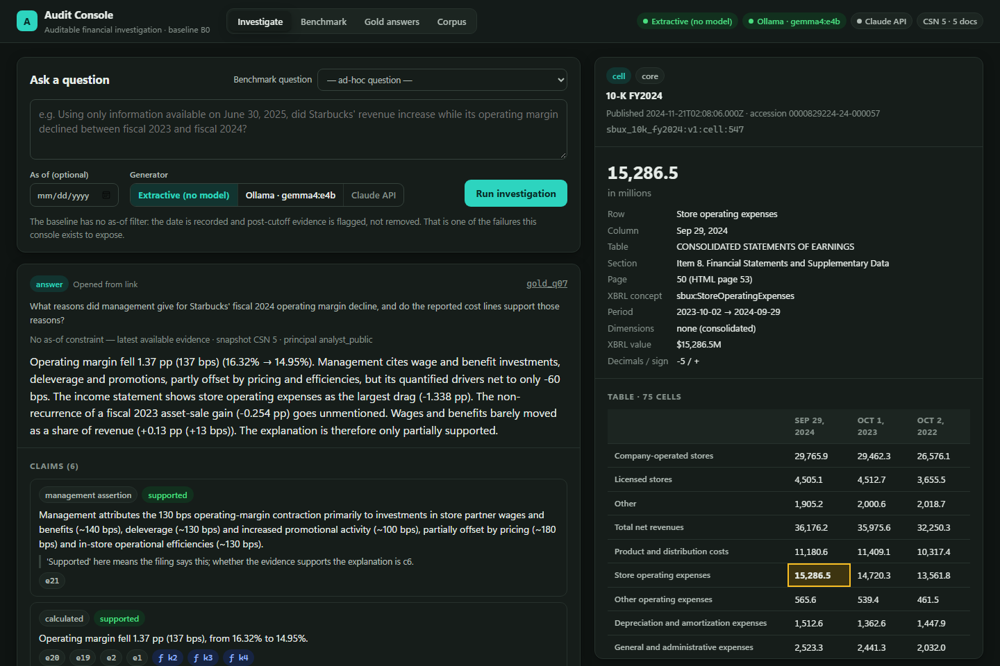

# Auditable Financial Investigation Platform

[](https://github.com/AashutoshR/rag-financial-capstone/actions/workflows/tests.yml)

A retrieval-augmented system for investigating financial questions across SEC filings, where **every answer is an
inspectable artifact**: claims, citations down to the table cell, calculations executed in code, conflicts, and
reasons for abstaining. It's built to make RAG failures visible, not to hide them: wrong periods, future
information leaking into historical answers, segment figures mistaken for company totals, and management
explanations that don't add up.



## What's here today

| Area | Status |
|---|---|
| Corpus | Starbucks: FY2023 and FY2024 10-K, Q2 FY2025 10-Q, plus two deliberate traps (an earnings release with non-GAAP margins, and the FY2025 10-K published after the 2025-06-30 test cutoff). Stored immutably and verified by SHA-256. |
| Evidence extraction | Inline-XBRL HTML parser: passages, tables, and cells with row/column headers, scale, sign, XBRL concept, period and dimensions, plus a positional anchor back into the original filing. Of 2,296 tagged cells, 2,140 match the SEC's XBRL API exactly, **0 mismatch**, and 156 use company-specific concepts the API doesn't publish. |
| Baseline (B0) | BM25 top-8 with three generators: deterministic extractive, a local model via [Ollama](https://ollama.com), or the Claude API. |
| Benchmark | 27 dev questions (20 core + 7 frontier) with expected values, evidence, directions, abstentions and item-specific checks; 3 hand-written gold answers whose numbers are computed from cited cells. |
| Scorer | Scored separately for retrieval, numbers, direction of change, approximation, checks, abstention, citation support and temporal leakage. Tested with 47 hand-written correct and wrong answers. |
| Web console | Ask questions, inspect any citation down to the cell and the stored filing, and browse benchmark results and gold answers. |
| Tests | 68 tests, run on Linux and Windows with Python 3.12 and 3.14 in CI. |

Planned work is in [IMPLEMENTATION_CHECKLIST.md](IMPLEMENTATION_CHECKLIST.md). The full specification, including the
Frontier tier, is in [PROJECT_REQUIREMENTS.md](PROJECT_REQUIREMENTS.md).

## Quick start

Requires Python 3.12+.

**Windows (PowerShell)**

```powershell
git clone https://github.com/AashutoshR/rag-financial-capstone.git
cd rag-financial-capstone
python -m venv .venv
.\.venv\Scripts\python.exe -m pip install -r requirements.txt
.\.venv\Scripts\python.exe -m app.bootstrap
.\.venv\Scripts\python.exe -m uvicorn app.server:app --port 8000
```

**macOS / Linux**

```bash
git clone https://github.com/AashutoshR/rag-financial-capstone.git
cd rag-financial-capstone
python3 -m venv .venv
.venv/bin/python -m pip install -r requirements.txt
.venv/bin/python -m app.bootstrap
.venv/bin/python -m uvicorn app.server:app --port 8000
```

Then open http://localhost:8000. `app.bootstrap` verifies the stored filings against the manifest, extracts the
evidence, builds the gold answers and runs the baseline. It takes well under a minute and needs no network access.

## Using the console

- **Investigate**: ask your own question, or pick a benchmark question so the run is scored automatically. You can set
  an as-of date and choose a generator.
- **Inspect evidence**: click any citation, calculation input or retrieved unit. The inspector shows the exact cell or
  passage with its table, XBRL tag and page, and can open the stored filing scrolled to that spot. Filings are treated
  as untrusted content, so they're served with scripts and external loading blocked.
- **Shareable links**: `#/artifact/<artifact id>` opens an answer, and `#/artifact/<artifact id>/<unit id>` also opens a
  piece of its evidence, for example `http://localhost:8000/#/artifact/gold_q07/sbux_10k_fy2024:v1:cell:547`.
- **Benchmark, Gold answers, Corpus**: metrics and per-question failures, the hand-written reference answers, and the
  source documents.

### Generators

| Generator | Needs | Notes |
|---|---|---|
| Extractive | nothing | Deterministic lower bound: returns the best-matching table row or sentence |
| Ollama | Ollama running locally, with the model pulled (`ollama pull gemma4:e4b`) | Default model `gemma4:e4b`; set `OLLAMA_MODEL` / `OLLAMA_URL` to change |
| Claude API | `ANTHROPIC_API_KEY` | Default model `claude-opus-5-5`; set `B0_MODEL` to change |

Investigations run one at a time. For the local model:

- **CPU only by default** (`OLLAMA_NUM_GPU=0`). On a laptop whose 8 GB GPU was mostly used by other apps, GPU offload
  stalled a run for 777 s; CPU-only runs take about 40 s with the model loaded, and 2–3 minutes when it has to load.
- **Live progress and Cancel**: the console shows whether the model is reading the evidence or writing the answer, and
  Cancel stops a run in under a second.
- **Stall watchdog**: a run is stopped, with an explanation, if no token arrives within `OLLAMA_FIRST_TOKEN_S` (default
  420 s) or if tokens stop for `OLLAMA_TOKEN_GAP_S` (default 60 s).
- **Automatic reset**: after a cancel or stall the model is unloaded. Ollama 0.40.6 can stop serving requests after a
  client disconnects mid-answer, and unloading clears that. The next run then reloads the model.

## Baseline results

The extractive baseline on the 27 dev questions ([full report](bench/reports/b0_extractive.md)):

| Metric | Result |
|---|---|
| Required evidence retrieved in the top 8 | 8/40 (20%) |
| Required evidence retrieved in the top 20 | 14/40 (35%) |
| Numbers stated correctly | 5/28 (18%) |
| Direction of change stated correctly | 0/9 |
| Item-specific checks passed | 1/18 |
| Correct abstentions | 0/3 |
| As-of questions shown post-cutoff documents | 3/4 |

The baseline is supposed to fail; each later mechanism has to beat it measurably. The failure analysis is in
[docs/first_session_log.md](docs/first_session_log.md). The largest causes:

- **Calculation inputs aren't retrievable by the question's words.** "Operating margin" never appears next to
  operating income and revenue, so the income statement ranks 155th–344th for margin questions.
- **Period blindness.** Tables say "Sep 29, 2024", questions say "fiscal 2024", and BM25 can't tell FY2024 from FY2025.
- **No time filter.** Post-cutoff filings reach the generator; one answer cited a 10-K published after the cutoff even
  though an eligible filing said the same thing.

The real filings also contain cases that make good benchmark items: management's quantified margin drivers net to
−60 bps while explaining a −130 bps decline; the same buyback is displayed identically in two 10-Ks but tagged with
opposite XBRL signs; and Japan's revenue is only disclosed bundled with Canada and the U.K.

## Command reference

| Step | Command |
|---|---|
| Rebuild everything derived | `python -m app.bootstrap` |
| Re-download filings (needs network; set `SEC_USER_AGENT` to `"your-name you@example.com"`) | `python -m app.ingest` |
| Extract evidence units | `python -m app.extract` |
| Inspect tables and cross-check against the SEC XBRL API | `python -m bench.inspect_tables` |
| Check every benchmark evidence spec resolves | `python -m bench.evidence` |
| Build gold answers | `python -m bench.make_gold` |
| Run the baseline | `python -m bench.run_b0 --generator extractive` (or `ollama`, `llm`) |
| Run the web console | `python -m uvicorn app.server:app --port 8000` |
| Run the tests | `python -m pytest -q` |

## Repository layout

```
app/          ingestion, extraction, retrieval, calculations, artifacts, baseline generators, web API
web/          console front end (plain HTML/CSS/JS, no build step)
bench/        benchmark questions, gold answers, scorer and fixtures, reports
corpus/       sources.json (what to ingest) and manifest.jsonl (what was ingested, with hashes)
data/blobs/   the stored source filings (committed; verified by SHA-256)
data/raw/     SEC XBRL company-facts snapshot used for cross-checks
docs/         session log and failure analysis, table inspection report, images
tests/        unit, scorer, server and local-model control tests
```

`data/extracted/` and `data/runs/` are generated and not committed.

## License

Code is released under the [MIT License](LICENSE). The SEC filings under `data/blobs/` are public records from
[EDGAR](https://www.sec.gov/edgar) and are not covered by the license.
