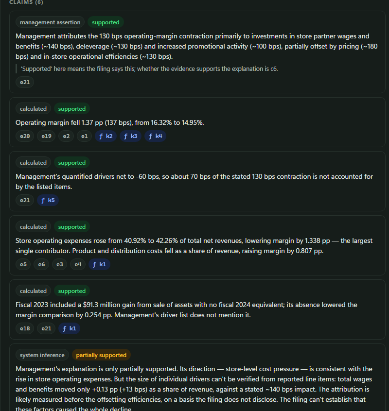
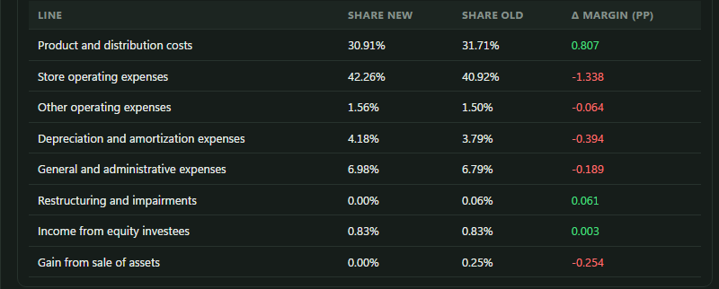
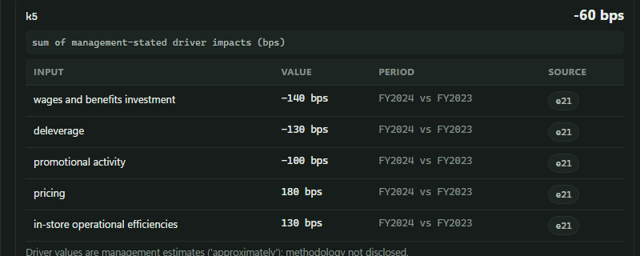
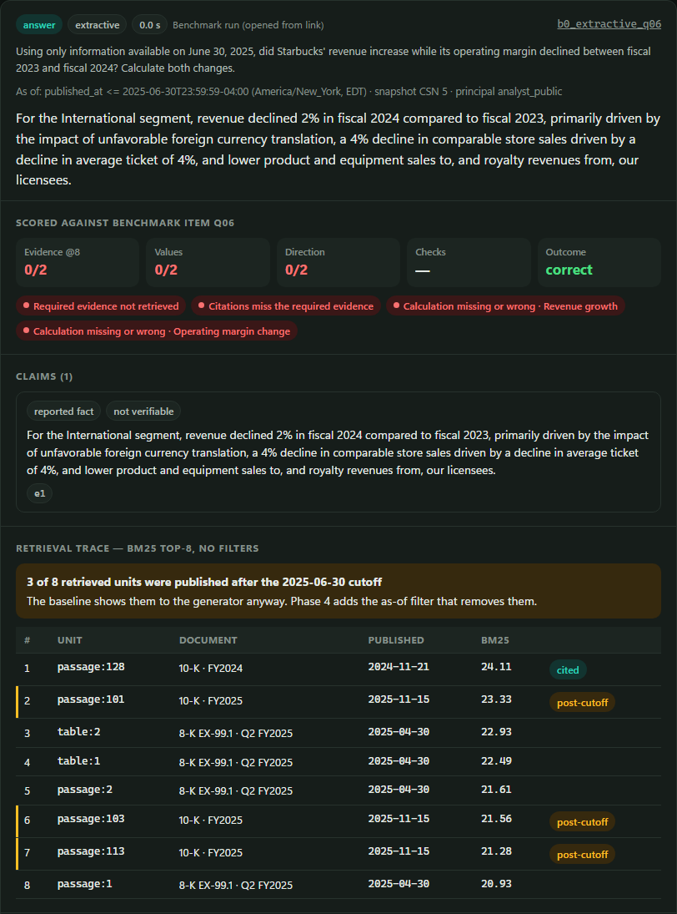
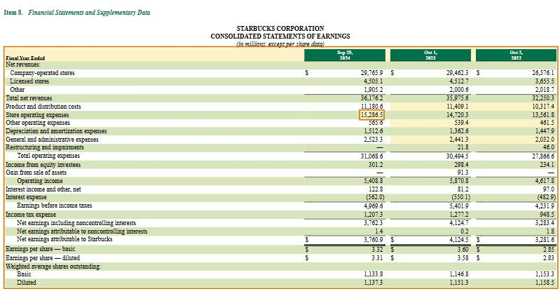
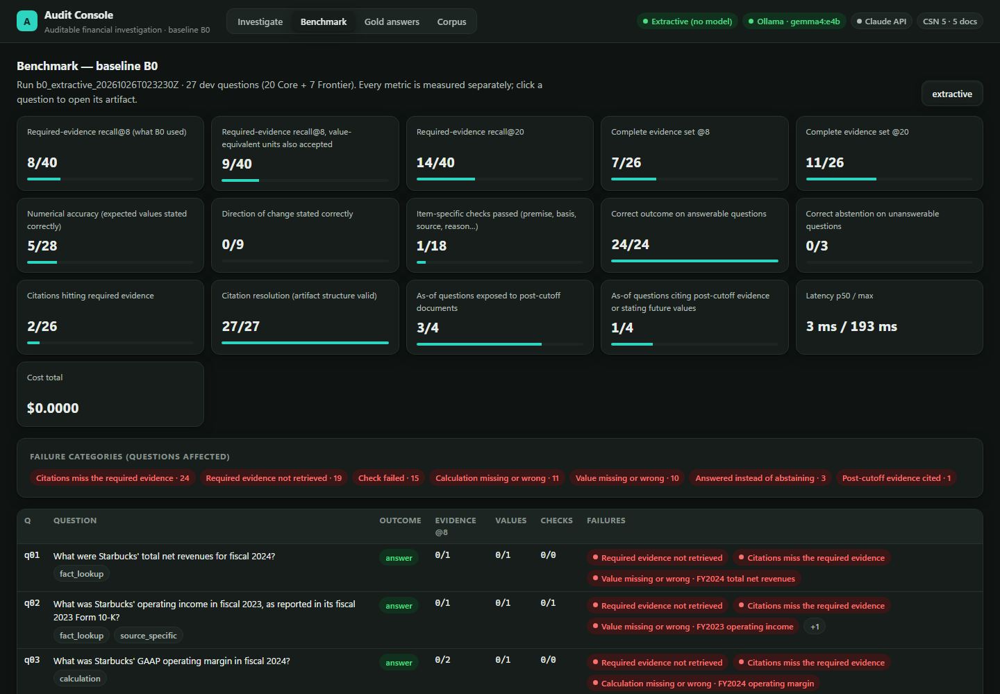

# Auditable financial investigation with RAG

[](https://github.com/AashutoshR/rag-financial/actions/workflows/tests.yml)

This is my capstone project: a retrieval-augmented system that answers questions about company financials from SEC
filings, and shows its work. Every answer comes with the claims it makes, the exact table cells or passages behind
each claim, the calculations (run in code, not by the model), and the reasons it refused to answer when the evidence
wasn't there.

I care less about getting a nice-sounding answer than about being able to check it. Financial questions are full of
traps a normal RAG pipeline walks straight into: the wrong fiscal year, a segment number passed off as the company
total, a figure from a filing that wasn't published yet on the date you asked about, or a management explanation that
doesn't actually add up. This project is built to catch those, and to make it obvious when it doesn't.


Right now the corpus is Starbucks' FY2023 and FY2024 annual reports and its Q2 FY2025 quarterly report, plus two
documents I added on purpose as traps (more on those below).

## How it works

### 1. Collecting the filings

The filings are downloaded from SEC EDGAR once and stored exactly as they were, named by their SHA-256 hash. A manifest
records, for each one, when it was published (the EDGAR acceptance time), when I ingested it, and its hash. That
matters later: a question like "using only what was known on June 30, 2025" needs to know which documents existed on
that date, and an answer should always be traceable to the exact version of the file it read.

Two of the five documents are traps. One is the Q2 FY2025 earnings release, which reports a non-GAAP operating margin
(8.2%) next to the GAAP one (6.9%). The other is the FY2025 annual report, published in November 2025, after the
cutoff date several test questions use. It repeats FY2024 numbers, so it's an easy way to leak future information into
a historical answer.

### 2. Turning filings into evidence

SEC filings today are HTML with inline XBRL tags. The extractor walks each filing and produces evidence units:
passages of text, whole tables, and individual table cells. A cell keeps its row and column headers, the scale
("in millions"), whether it was shown as negative, and the XBRL tag behind it (concept, period, segment). Each unit
also remembers where it sits in the original HTML, so the console can jump straight to it later.

To make sure the parsing is right, I cross-checked every tagged cell against the SEC's own XBRL data. Of 2,296 cells,
2,140 match exactly, none disagree, and the other 156 use Starbucks-specific tags the SEC's API doesn't publish.

### 3. Retrieving evidence and answering

The current system is deliberately simple, because it's the baseline everything else has to beat. It retrieves the
top 8 evidence units with BM25 (keyword search), with no date filter and no access control, and hands them to one of
three answer generators:

- an extractive one that just returns the best-matching line, with no model at all
- a local model through [Ollama](https://ollama.com) (`gemma4:e4b` by default)
- the Claude API, if you set `ANTHROPIC_API_KEY`

### 4. The answer artifact

Every run produces a JSON artifact, and the console renders it. Claims are labeled by type (a reported fact, a
calculation, something management said, or the system's own inference) and by how well the evidence supports them.



Calculations are done in Python with exact decimals, and every input points back to the cell it came from. This one
breaks Starbucks' FY2024 operating-margin decline into the contribution of each cost line. The numbers sum exactly to
the −1.37 point change, and a test checks that they do.



That breakdown is how the system tests management's explanation. In the 10-K, management says the 130 basis point
decline was mainly due to wage investments, deleverage and promotions, partly offset by pricing and efficiencies. Their
own numbers for those drivers add up to only −60 basis points.



So the answer marks the explanation as only partially supported. It doesn't claim to know the cause; it just shows
what the filing can and can't back up.

### 5. Checking the answers

There are 27 benchmark questions so far, each with the values a good answer has to contain, the evidence it should
use, and specific things to check: did it correct a false premise, say whether a margin is GAAP or non-GAAP, give a
range when the input was "approximately 72%", or abstain when the data simply isn't disclosed. Each part is scored
separately. The scorer itself is tested against 47 hand-written answers, correct and wrong, because a scorer that
quietly accepts wrong answers is worse than none.

Here's the baseline on one of the as-of questions. It got the evidence wrong and never did the calculation, and three
of the eight passages it looked at were published after the cutoff date:



### 6. Inspecting the source

Click any citation and the inspector shows the cell inside its table, with its XBRL tag and page number. From there you
can open the original filing, scrolled to that cell and highlighted:



Filings are treated as untrusted content, so the console shows them with scripts and external loading blocked, and
never inserts document text into the page as HTML.

### 7. The benchmark page

All of it adds up to a scoreboard, where every metric is measured on its own and you can click into any question:



## How the baseline does

| | Result |
|---|---|
| Required evidence in the top 8 results | 8 of 40 |
| Required evidence in the top 20 | 14 of 40 |
| Numbers stated correctly | 5 of 28 |
| Direction of change stated correctly | 0 of 9 |
| Question-specific checks passed | 1 of 18 |
| Correct refusals on unanswerable questions | 0 of 3 |

That's bad, and it's supposed to be. The interesting part is why. Questions about operating margin can't find the
income statement, because the word "margin" never appears next to operating income and revenue; the right table ranks
somewhere between 155th and 344th. Tables label columns "Sep 29, 2024" while questions say "fiscal 2024", and keyword
search can't tell FY2024 from FY2025 anyway. With no date filter, one answer even quoted the right number from a
report that hadn't been published yet on the question's date. The full analysis is in
[docs/first_session_log.md](docs/first_session_log.md), and the complete report in
[bench/reports/b0_extractive.md](bench/reports/b0_extractive.md).

The real filings turned out to be good test material on their own. Besides the drivers that don't add up, the same
share buyback is displayed identically in two annual reports but tagged with opposite signs in XBRL, which a naive
system would report as a restatement. And Japan's revenue is only ever disclosed lumped in with Canada and the U.K.

## Running it

You need Python 3.12 or newer. On Windows (PowerShell):

```powershell
git clone https://github.com/AashutoshR/rag-financial.git
cd rag-financial
python -m venv .venv
.\.venv\Scripts\python.exe -m pip install -r requirements.txt
.\.venv\Scripts\python.exe -m app.bootstrap
.\.venv\Scripts\python.exe -m uvicorn app.server:app --port 8000
```

On macOS or Linux it's the same, using `python3` to create the environment and `.venv/bin/python` instead of
`.\.venv\Scripts\python.exe`.

Then open http://localhost:8000. The bootstrap step checks the stored filings against their hashes, extracts the
evidence, builds the gold answers and runs the baseline. It takes under half a minute and doesn't need the internet.

A few other things you can run:

```bash
python -m pytest -q                                  # the test suite
python -m bench.run_b0 --generator ollama            # score the local model on all 27 questions
python -m bench.inspect_tables                       # re-check extraction against the SEC's XBRL data
python -m app.ingest                                 # re-download the filings (set SEC_USER_AGENT to "name email" first)
```

Links to answers can be shared: `http://localhost:8000/#/artifact/gold_q07` opens that answer, and adding an evidence
id after it (for example `/sbux_10k_fy2024:v1:cell:547`) opens that cell in the inspector too.

## Notes on running a local model

I run Ollama on a laptop, and a few things there were worth handling properly. By default the model runs on the CPU
(`OLLAMA_NUM_GPU=0`): when other apps had filled the 8 GB GPU, offloading to it stalled a run for almost 13 minutes,
while the same question takes about 40 seconds on the CPU once the model is loaded. The console shows live progress
and has a Cancel button, and it stops a run on its own if the model goes quiet for too long (`OLLAMA_FIRST_TOKEN_S`,
default 420 seconds, and `OLLAMA_TOKEN_GAP_S`, default 60). I also found that Ollama 0.40.6 can stop answering
altogether after a client disconnects mid-answer, so after any cancel or stall the console unloads the model, and the
next run starts clean.

## What's next

This is the first of several phases. Next up is better retrieval (labeling tables with fiscal periods, indexing table
rows, metadata filters, dense and hybrid search), then calculations planned by the system itself, proper as-of
filtering with restatements, multi-step investigation, and finally permissions, so users only see documents they're
allowed to. Each step has to beat the baseline on the benchmark to stay in. The plan is in
[IMPLEMENTATION_CHECKLIST.md](IMPLEMENTATION_CHECKLIST.md), and the full specification, including a harder "frontier"
tier, is in [PROJECT_REQUIREMENTS.md](PROJECT_REQUIREMENTS.md).

## Layout

```
app/        ingestion, extraction, retrieval, calculations, answer artifacts, generators, web API
web/        the console (plain HTML, CSS and JavaScript)
bench/      questions, gold answers, scorer, reports
corpus/     what to download, and the manifest of what was stored
data/       the stored filings and an SEC XBRL snapshot (generated data isn't committed)
docs/       the session log with the failure analysis, and the images used here
tests/      70 tests, run on Linux and Windows on every push
```

## License

The code is MIT licensed (see [LICENSE](LICENSE)). The SEC filings in `data/blobs/` are public records from
[EDGAR](https://www.sec.gov/edgar) and aren't covered by that license.
